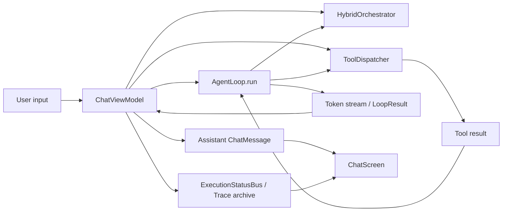
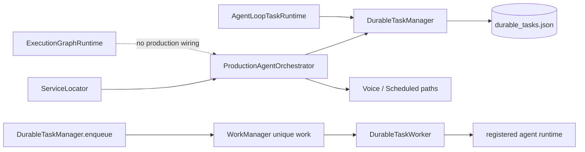
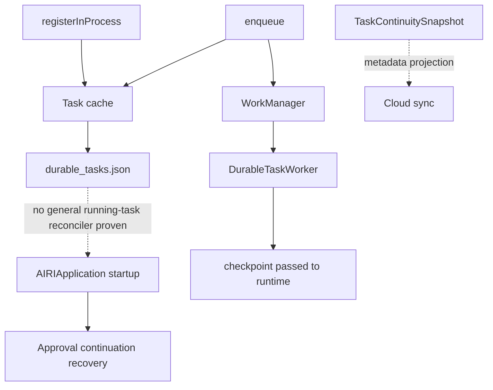
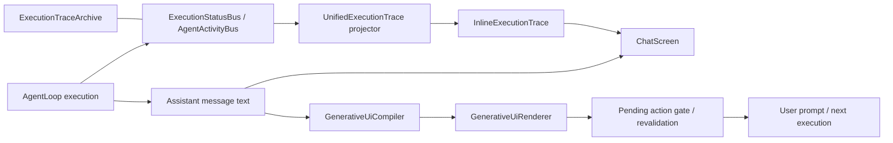
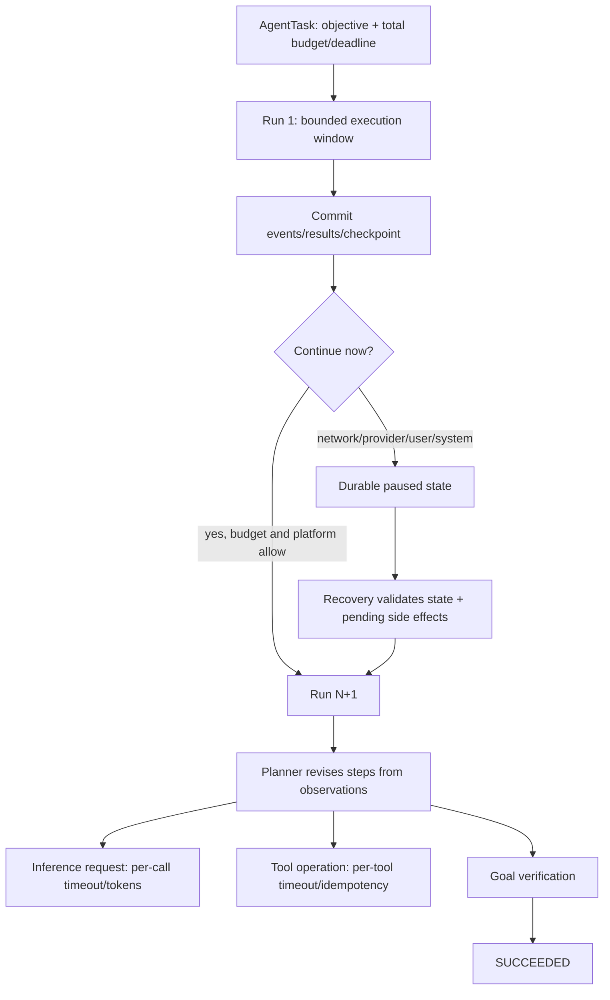
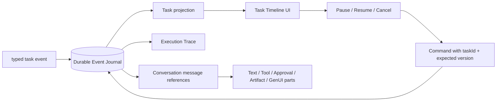

# AIRI — خطة P0 لتنفيذ الوكيل الذاتي والاستمرارية والاستعادة

**النوع:** خطة تنفيذ هندسية منقحة؛ ليست تقرير اختبار أو إثبات جاهزية

**الفرع المرجعي:** `main`

**HEAD المرجعي للتدقيق الأصلي:** `a9d8177dfd7a7e928623d88bd0489fe635f2c443` (`origin/main` عند إنشاء الخطة)

**حالة العمل الحالية أثناء التنقيح:** تغييرات P0 محلية غير ملتزمة في `DurableTask.kt` و`DurableTaskManager.kt` واختبار العقد؛ ووثيقة الخطة نفسها قيد التعديل.
**نطاق الخطة:** Android Agent Runtime وAgentLoop وDurable Tasks وOrchestration وExecution Trace وChat UI وGenUI وProvider Management وNetwork Recovery وTask Continuity، مع مراجعة Desktop عند الصلة.

التدقيق المرجعي الأصلي كان مراجعة ساكنة للـ`main` عند commit أعلاه. خلال التنفيذ اللاحق أضيف محلياً إيقاف Worker بحالة `PAUSED/WORKER_INTERRUPTED` واختبار عقد محدث، لكن اختبار Gradle المحدد لم يبدأ بسبب غياب Android SDK (`ANDROID_HOME`/`ANDROID_SDK_ROOT` غير مضبوطين). لا يُدّعى نجاح اختبار بناء/تشغيل أو process-death. أُعيدت آثار Gradle المؤقتة. فيديو Manus المشار إليه في وصف أسبق لم يكن متاحاً كملف؛ لا تُنسب إليه ملاحظات مرئية.

## 1. التقييم التنفيذي

AIRI لديه أجزاء حقيقية ومفيدة من النظام المطلوب: AgentLoop يعمل في طلبات الدردشة؛ موزع أدوات يمرر نتائج التنفيذ للنموذج؛ خدمة مهام دائمة تحفظ كيان DurableTask وتدعم جدولة WorkManager؛ استمراريات موافقة محددة؛ تصنيف لبعض أخطاء المزود وإعادة محاولة؛ وسجل Trace مستقل يمكن أرشفته وربطه برسالة. هذه مكونات قابلة للتطوير، ولا مبرر لاستبدالها بنظام موازٍ.

لكن لا توجد حالياً دورة حياة موحدة تجعل طلب الدردشة العادي مهمة طويلة قابلة للاستعادة تلقائياً. المسار الفعلي هو `ChatViewModel → AgentLoop → HybridOrchestrator/ToolDispatcher`، في حين أن `ProductionAgentOrchestrator` مسار منفصل ولا يوجّه كل طلب دردشة. `ExecutionGraphRuntime` باقٍ في المصدر لكنه غير منشأ في ServiceLocator؛ ويصرح ServiceLocator بأن ربطه وwatchdog أزيلا بعد عدم العثور على callers. لذلك لا ينبغي اعتبار وجود DurableTask أو Graph runtime في الشجرة دليلاً على أن مسار المحادثة يمر بهما.

الفجوة الأهم ليست زيادة `MAX_STEPS` وحدها. `AgentLoop` محدود افتراضياً بـ16 دورة نموذج، و120 ثانية خمول، وسقف 15 دقيقة داخل نطاق من الحلقة. هذه ميزانيات متباينة عن مهلات موفري النموذج والأدوات وإعادات الشبكة وحدود WorkManager. كما أن الاستدعاء غير المربوط أو غير المتعاون قد لا يتوقف بمجرد إلغاء coroutine.

`DurableTaskManager.enqueue` يحفظ المهمة ثم يرسلها إلى WorkManager، لكن البحث في مصادر Kotlin لم يجد نداءً لتلك الدالة تحديداً؛ والنداءات الموجودة لـ`registerInProcess` تحفظ تسجيل تنفيذ foreground ولا تنشئ WorkManager work. لهذا، حفظ مهمة الدردشة لا يثبت استعادة تنفيذها بعد قتل العملية. عامل المهمة يعيد استدعاء تنفيذ المهمة ويمرر checkpoint، لكن هذا لا يثبت إعادة التشغيل من الخطوة التالية أو منع تكرار side effect.

الحكم المقترح: CRITICAL_P0 يشمل سلامة حالة المهمة والتخزين/المصالحة، صلة الرسائل بالمهمة الصحيحة والتمييز بين Continuation وNew Mission، سجل الآثار الجانبية والعمليات الخارجية المنتظرة، حالات pause للميزانية/المزود، والميزانيات متعددة الطبقات. P1 وP2 يصفان ترتيب العمل لا وجود المكوّن. لا يُنصح بالادعاء أن AIRI سيعمل ساعتين أو ثلاثاً في استدعاء أو Worker واحد؛ الهدف عمر مهمة ممتد عبر Runs قصيرة، مع انتظار خارجي مستدام لا يحتجز Run.

## 2. النطاق والمنهج وحالة المستودع

عند التدقيق الأصلي كان `HEAD == origin/main == a9d8177...` والشجرة نظيفة؛ هذه معلومة تاريخية عن نقطة البدء لا تصف الشجرة الحالية. لم تُخلط نتائج أي فرع آخر مع `main`. الملف الحالي خطة في جذر المشروع، وبالتوازي توجد تغييرات P0 محلية غير ملتزمة في المصدر والاختبار كما يذكر الرأس.

الملفات الأساسية التي جرى تتبعها تشمل:

- التنفيذ: `app/src/main/java/com/airi/assistant/agent/loop/AgentLoop.kt`، `AgentLoopTaskRuntime.kt`، `agent/orchestrator/ProductionAgentOrchestrator.kt`، `agent/execution/runtime/ExecutionGraphRuntime.kt`، `execution/AgentOrchestrator.kt`، `execution/HybridOrchestrator.kt`.
- المهام والاستعادة: `agent/durable/DurableTask.kt`، `DurableTaskManager.kt`، `TaskContinuitySnapshot.kt`، `ApprovalContinuation.kt`، إضافة إلى `AIRIApplication.kt` و`core/ServiceLocator.kt`.
- الواجهة والتتبع: `ui/viewmodel/ChatViewModel.kt`، `ui/screens/ChatScreen.kt`، `ui/trace/InlineExecutionTrace.kt`، `UnifiedExecutionTrace.kt`، `ui/activity/AgentLifecycleTrackerPanel.kt`، `AgentActivityBus.kt`، `GlobalAgentEventDispatcher.kt`، `core/ExecutionTraceGateway.kt`، `ExecutionTraceArchive.kt`.
- GenUI: `ui/text/ContentAwareMessageRenderer.kt`، `ui/generative/GenerativeUiCompiler.kt`، `GenerativeUiRenderer.kt`، `GenerativeUiStateStore.kt`، `PendingGenerativeUiActionGate.kt`.
- الخلفية والمزودون: Workers في `app/src/main/java/com/airi/assistant/**`، الخدمات والـmanifest، `execution/backend/CloudBackend.kt`، `execution/cloud/CloudErrorMapper.kt`، `RetryPolicy.kt`، adapters، وسياسات cancellation.
- الاختبارات المرجعية: `DurableTaskProductKernelTest.kt`، `DurableTaskRetryContractTest.kt`، `ProjectFileApprovalRecoveryTest.kt`، `AgentLoopExecutionContextTest.kt`، `AgentLoopVerticalIntegrationTest.kt`، `ExecutionGraphRuntimeContractTest.kt`، واختبارات trace وGenUI وتصنيف المزود.

درجة الثقة عالية في وصلات الاستدعاء المباشرة والحدود الثابتة التي أُحيل إلى أسطرها؛ ومتوسطة في أحكام الغياب لأنها ناتجة من بحث ساكن في checkout، لا من إثبات استحالة كل إنشاء ديناميكي. لا توجد نتائج تشغيل Android أو process-death أو network fault injection في هذا التدقيق.

## 3. خريطة المسارات الحالية

### 3.1 طلب الدردشة الاعتيادي



`ChatViewModel` ينشئ AgentLoop ويستدعي `agentLoop.run` لطلب الدردشة مع execution/message/session IDs وcallbacks (راجع `ChatViewModel.kt:621-634,3377-3405`). أدوات AgentLoop تمر عبر dispatcher، وتعود النتيجة لسياق النموذج (`AgentLoop.kt:1454-1643,1800-1827`). النتيجة النهائية تعالجها ViewModel وتحفظها كرسالة/عرض مع metadata (`ChatViewModel.kt:3568-3591,3752-3786`). لا تساوي هذه الدورة وحدها بين الطلب ومهمة طويلة العمر.

### 3.2 المسارات الموجودة لكن غير الموحدة مع الدردشة



`ProductionAgentOrchestrator` مربوط بمدير المهام في ServiceLocator (`ServiceLocator.kt:428-436`) ويستعمل في مسارات معينة مثل الصوت/المهام المجدولة. لا يتولى المسار الاعتيادي لرسالة ChatViewModel. كما أن `ServiceLocator.kt:438-446` يصرح بإزالة `executionGraphRuntime` و`executionWatchdog` لعدم وجود callers. `registerInProcess` و`enqueue` مختلفان وظيفياً (`DurableTaskManager.kt:83-115`)؛ وجود واجهة enqueue لا يثبت أن التطبيق يستدعيها. هذه أهم نقاط الربط المفقودة.

### 3.3 التخزين والتعافي الحاليان



يوجد تحميل وحفظ للمهام في ملف JSON، مع كتابة مؤقتة ثم rename؛ لكن التنفيذ وتخزين الملفات وWorkManager لا يشكلون معاملة موحدة. استعادة الموافقات المحددة عند الإقلاع لا تعني استعادة أي AgentLoop قُتل. `TaskContinuitySnapshot` يصف التقدم، ولا يحتوي وحده على المدخلات/المخرجات اللازمة لإعادة تشغيل آمنة. `AdaptiveCheckpointStore` موصوف كتخزين ذاكرّي.

### 3.4 Trace وChat وGenUI



التصميم الحالي يفصل نص الرد عن trace، وهذا فصل صحيح مبدئياً ولا ينبغي استبداله برسالة محادثة مصطنعة لكل حدث. بعض trace يؤرشف بملف ويرتبط بمعرف الرسالة؛ أما ActivityBus وحالة GenUI وبعض snapshots فهي إسقاطات عرض/ذاكرة وليست حالة تنفيذ دائمة. GenUI تمر عبر compile typed وإعادة تحقق وgate قبل الإجراء، لكنها ليست Journal موحداً لكل مراحل المهمة (`InlineExecutionTrace.kt:16-105`، `ExecutionTraceArchive.kt:12-19,41-69,146-185`، `PendingGenerativeUiActionGate.kt:3-45`).

## 4. مصفوفة الوضع الحالي

يُفصل **وضع التنفيذ الحالي** عن **أولوية التنفيذ**: الأول يصف ما يوجد في الشفرة/التكامل، والثاني يصف أثر الفجوة على استمرارية المهمة. `CRITICAL_P0` قد يكون عملاً غير موجود إطلاقاً. الحالات المسموحة هي `IMPLEMENTED_NEEDS_IMPROVEMENT` و`IMPLEMENTED_NEEDS_INTEGRATION` و`NOT_IMPLEMENTED`.

| المكوّن | التنفيذ والاستعمال الفعلي في `main` | القيد / الفجوة | Current Implementation Status | Implementation Priority | الأدلة الأساسية | التغيير المطلوب |
|---|---|---|---|---|---|---|
| AgentLoop / ChatViewModel | مسار طلب الدردشة الفعلي يمر بهما؛ افتراضياً 16 دورة قرار و120 ثانية خمول و15 دقيقة سقف للطلب الواحد | ليس عمر مهمة؛ حد دورات القرار لا يساوي عدد عمليات الأدوات | IMPLEMENTED_NEEDS_IMPROVEMENT | CRITICAL_P0 | `ChatViewModel.kt:3377-3405`; `AgentLoop.kt:94-108` | ربط task/run budgets وcheckpoint ومصالحة؛ سقف 100–200 للدورات فقط مع guards مستقلة للأدوات |
| HybridOrchestrator | يستخدمه AgentLoop لمسار الدردشة | لا يتشارك تلقائياً lifecycle مخزن المهمة مع مسارات ProductionAgentOrchestrator | IMPLEMENTED_NEEDS_INTEGRATION | P1 | `ChatViewModel.kt:621-634` | عقد runtime واحد للـtask/run دون دمج أصناف اعتباطي |
| ProductionAgentOrchestrator | مربوط بمدير المهام لمسارات منفصلة | ليس المسار العام لرسائل ChatViewModel | IMPLEMENTED_NEEDS_INTEGRATION | P1 | `ServiceLocator.kt:428-436`; `ProductionAgentOrchestrator.kt:605-790` | توحيد العقود وتحديد مواضع الربط الفعلي |
| DurableTask / JSON persistence | كيان غني نسبياً وحفظ/تحميل محلي؛ أضيف محلياً pause عند انقطاع Worker | JSON ليس تخزيناً معاملّياً؛ فشل الحفظ/التزامن/تعدد الكتابة والمصالحة غير مثبتة | IMPLEMENTED_NEEDS_IMPROVEMENT | CRITICAL_P0 | `DurableTaskManager.kt:62-76,763-835`; تغييرات محلية غير ملتزمة | اعتماد ADR وتخزين task/run/step/outbox وعمليات خارجية بمعاملات، مع ترحيل/تصدير آمن |
| `enqueue` / `registerInProcess` | `enqueue` يحفظ ويرسل WorkManager؛ `registerInProcess` يسجل فقط | لا مستدعٍ ظاهر لـ`DurableTaskManager.enqueue` في Kotlin؛ لا outbox/reconciliation يضمنان جدولة كل محفوظ مرة واحدة | IMPLEMENTED_NEEDS_INTEGRATION | CRITICAL_P0 | `DurableTaskManager.kt:83-115`; `AgentLoopTaskRuntime.kt:47` | transactional outbox + reconciler + scheduler idempotent |
| DurableTaskWorker | يبدأ run وينفذ agent؛ الفرع المحلي الحالي يحفظ interruption كـPAUSED ولا يعيد إحياء CANCELLED | لا يوجد استئناف عام مثبت عند الخطوة التالية؛ retries العامة قد تعيد تنفيذ agent كاملاً | IMPLEMENTED_NEEDS_IMPROVEMENT | CRITICAL_P0 | `DurableTaskManager.kt:918-1007`; `DurableTaskRetryContractTest.kt` | worker يستأنف خطوة محددة بعد reconciliation فقط؛ لا replay لأثر مجهول |
| Continuation مقابل New Mission | task IDs وmessage IDs موجودة في مواضع منفصلة | لا أساس تنفيذي مثبت يحسم الارتباط؛ طلب جديد لا يجوز أن يلغي pause أو يبدأ Resume من الصفر | NOT_IMPLEMENTED | CRITICAL_P0 | `ChatViewModel.kt`; `AgentLoopTaskRuntime.kt`; لا يوجد caller مثبت لمسار enqueue من Chat | ربط كل رسالة/أمر بمعرّف task صريح، مع command منفصل لـContinue وNew Mission؛ UI المتقدم ليس شرطاً |
| ExternalOperation / انتظار CI وغيره | لا يوجد كيان دائم موحد لعملية خارجية مع poll/webhook recovery | انتظار ممتد داخل Run غير آمن؛ لا يستأنف Run جديد عند اكتمال العملية | NOT_IMPLEMENTED | CRITICAL_P0 | بحث ساكن في `agent/durable/`؛ لا كيان ExternalOperation معروف | ledger دائم + webhook inbox أو polling مستدام محدود + بدء Run جديد عند النتيجة |
| ApprovalContinuation | استمرار موافقة محدد مع claim | لا exactly-once موزع عند crash بعد أثر خارجي؛ يجب ربطه بالـoutbox العام | IMPLEMENTED_NEEDS_IMPROVEMENT | CRITICAL_P0 | `ApprovalContinuation.kt:107-197`; `CalendarCreateRuntime.kt:240-328` | توحيد operation ledger والمصالحة والإلغاء |
| ExecutionGraphRuntime | مصدر واختبارات عقد موجودة | غير مربوط بمسار الإنتاج بحسب التدقيق | IMPLEMENTED_NEEDS_INTEGRATION | P1 | `ServiceLocator.kt:438-446`; `ExecutionGraphRuntime.kt:24-29` | قرار ربط قابل للاختبار أو إبقاؤه خارج claims الإنتاج |
| Workers وخدمات Android | WorkManager وخدمات لأعمال مختلفة | قيود النظام تمنع ضمان تشغيل غير محدود أو موعد دقيق | IMPLEMENTED_NEEDS_IMPROVEMENT | CRITICAL_P0 | `app/build.gradle.kts:21-27`; manifest؛ مراجع Android [1]-[6] | Run قصير + انتظار خارجي/مؤقت دائم + قيود API موثقة |
| Provider error mapping | `CloudErrorMapper` و`CloudErrorType` موجودان ويصنفان حالات متعددة | لا يميز كل من credit/spend/quota؛ لا نموذج موحد غني لـRetry-After؛ classification موزع/نصي جزئياً | IMPLEMENTED_NEEDS_IMPROVEMENT | CRITICAL_P0 | `CloudErrorMapper.kt:16-87`; `CloudErrorType.kt:23-36`; `CloudBackend.kt:220-253` | تطوير mapper نفسه ومكيّفات مزود داخله؛ لا إنشاء ProviderFailureClassifier موازٍ |
| ميزانيات المهمة/الـRun/الأدوات | توجد حدود محلية في AgentLoop ومحاولات retry متفرقة | لا ميزانيات مستقلة موحدة ولا `PAUSED_BUDGET` وأسبابها typed | IMPLEMENTED_NEEDS_IMPROVEMENT | CRITICAL_P0 | `AgentLoop.kt:94-108`; policy files الحالية | Budget object متعدد الأبعاد؛ حفظ checkpoint وعدم تحويل قابل للتمديد إلى FAILED |
| Trace وActivity | Trace حي وأرشيف لبعض المسارات | ليست Task state دائمة موحدة | IMPLEMENTED_NEEDS_IMPROVEMENT | P1 | `ExecutionTraceArchive.kt`; `InlineExecutionTrace.kt`; `GlobalAgentEventDispatcher.kt` | projection من event journal مع IDs مترابطة |
| Chat Message / GenUI | رسالة إجابة وGenUI typed مع إعادة تحقق | لا ربط دائم يضمن استعادة المهمة الصحيحة عند الرسالة الجديدة | IMPLEMENTED_NEEDS_INTEGRATION | CRITICAL_P0 | `ChatScreen.kt:2440-2473`; `ContentAwareMessageRenderer.kt`; `GenerativeUiRenderer.kt` | ربط messageId/taskId كعقد؛ واجهة الإدارة المتعددة تبقى لاحقاً |
| TaskContinuitySnapshot | snapshot للتقدم/المزامنة | metadata وليس checkpoint تنفيذياً؛ غير صالح لإعادة آثار جانبية | IMPLEMENTED_NEEDS_IMPROVEMENT | CRITICAL_P0 | `TaskContinuitySnapshot.kt:3-51` | توثيقه projection وإضافة checkpoint تنفيذي معتمد |
| Desktop | تنفيذ وسجل محادثة منفصلان | لا scheduler/domain persistence مشترك مثبت | IMPLEMENTED_NEEDS_INTEGRATION | P2 | `app-desktop/**/DesktopAgent.kt` | مشاركة عقد المجال؛ تخزين/جدولة خاصة بالمنصة |
| Fault-injection وcentral acceptance | توجد اختبارات وحدات/عقود وموافقة متفرقة | لا دليل على دورة end-to-end لقتل العملية والـCI والميزانية والحصة وإصلاح الهدف | NOT_IMPLEMENTED | CRITICAL_P0 | اختبارات `DurableTask*`, `ProjectFileApprovalRecoveryTest.kt` لا تغطي السيناريو المركب | بوابة اختبار مركزية مؤتمتة؛ لا إغلاق P0 قبل نجاحها |

الصفوف تصف مراجعة ساكنة للمصدر المتاح ولا تعني أن الاختبارات شُغّلت. تصنيف الحالة لا يحدد الأولوية؛ غياب أساس ربط New Mission/Continuation أو ExternalOperation هو `NOT_IMPLEMENTED` لكنه `CRITICAL_P0`.

## 5. معمارية الهدف

### 5.1 حدود المجال وقرار التخزين (ADR-001)

اعتمد الكيانات التالية بعلاقات ثابتة:

- **AgentTask:** الهدف وعمره الكلي، المالك والسياق، حالة المهمة وسياسة الميزانية، روابط المحادثة/المشروع، نتيجة الإكمال وسبب التوقف.
- **ExecutionRun:** نافذة تنفيذ محدودة العمر؛ له `runId` مستقل وحالة/ميزانية/lease. يمكن إنهاؤه أو تعليقه خارجياً بينما تظل المهمة غير نهائية.
- **ExecutionStep:** مرحلة مخططة قابلة للتعديل، بترتيب/اعتماديات ونتائج تحقق.
- **ToolOperation:** نية أثر جانبي واحدة، `actionId`/idempotency key وpayload hash وحالة إرسال/مرجع/UNKNOWN.
- **ExternalOperation:** عملية بدأها AIRI لدى مزود خارجي وتستمر بعد إخلاء Run الحالي. حقول المجال الدنيا: `operationId`, `taskId`, `runId`, `stepId`, `externalProvider`, `externalReferenceId`, `externalStatus`, `startedAt`, `nextPollAt`, `lastCheckedAt`, `resultReference`, `timeoutPolicy`, `retryPolicy`, `cancellationState`. تحفظ أيضاً نسخة/ETag أو idempotency key، آخر خطأ منقح، poll count و`stateVersion` عند الحاجة. `externalStatus` داخلي موحد (`PENDING/RUNNING/SUCCEEDED/FAILED/CANCELLED/UNKNOWN`) مع raw provider status منقح اختيارياً. النتيجة الكبيرة Artifact منفصل وتُحفظ هنا إحالتها فقط.
- **ModelRequest:** استدلال محدد بمهلة وموازنة tokens/cost ومحاولات.
- **Checkpoint:** نسخة مخطط مرقمة لحالة آمنة، مرتبطة بـtask/run/step والسابقة؛ لا يعيد بناء side effect مبهم.
- **TaskEvent / Outbox:** أحداث typed مرتبة وidempotent، وأوامر عمل معلقة تُرسل بعد commit. لا تخلط event journal وoutbox ولا تعتبر enqueue خارج قاعدة البيانات ذرّياً.
- **Artifact:** ملف/نتيجة بملكية وتجزئة وموقع وسياسة حذف/تصدير.
- **ConversationMessage / MessagePart:** محتوى الحوار؛ كل رسالة تنفيذية ترتبط صراحة بـ`taskId` (أو تُوسم new mission) مع `messageId`، ولا تصبح بديلاً عن حالة التنفيذ.

#### القرار

**القرار المقترح: Hybrid storage بحدود واضحة.** على Android تكون Room/SQLite المصدر المعاملي لـtask/run/step/operation/external operation/outbox/event metadata، بشرط أن تقع السجلات التي يجب أن تتغير معاً في قاعدة SQLite واحدة وأن تثبت migration/backup على المشروع. تبقى artifacts والنتائج الكبيرة ملفات منفصلة بمراجع وhashes. JSON الحالي يظل صيغة ترحيل واستيراد/تصدير/نسخة احتياطية، لا مصدراً متزامناً ثانياً. مجال AIRI يتعامل عبر `TaskStore` interface؛ Desktop يشارك العقد والمخطط المنطقي ويستخدم SQLite implementation مناسباً له، لا يفرض Android Room runtime على JVM.

| الخيار | المعاملات والـoutbox | التزامن | الترحيل | سلامة البيانات | حجم الأحداث/الاحتفاظ | مشاركة Domain مع Desktop |
|---|---|---|---|---|---|---|
| JSON الحالي بعد تطويره | ممكن write-temp+fsync+rename لملف واحد، لكن لا transaction موحدة بين task وevents/outbox وجدولة WorkManager؛ يلزم journal/write-ahead يدوي | أقفال وإدارة تعدد كتابات/عمليات يدوية؛ مخاطر lost update | بسيط أولاً، يصبح معقداً مع schema evolution والـpartial recovery | قابل للتحسين بـhash/backup، لكن crash consistency والـmulti-record invariants عبء على AIRI | خط كامل يعاد serialize؛ compaction/append صعبان | أعلى مشاركة مباشرة لأن Kotlin models محايدة، لكن يحتاج تنفيذ locking وstorage كامل لـDesktop |
| Room/SQLite حصراً | معاملات وقيود/DAO قوية ضمن DB واحدة؛ outbox صفوف ذرّية مع المهمة؛ لا تشمل الملفات أو WorkManager | SQLite serializes writes ويقدم locking محلياً؛ ينبغي ضبط dispatch/query/load | migrations مدعومة لكن تحتاج tests ونسخ احتياطية | قيود/فهرسة/constraints؛ لا تمنع فساد القرص أو حدود المعاملة عبر APIs خارجية | صفوف قابلة للفهرسة/الاحتفاظ؛ تجنب حفظ blobs ضخمة | Room خاص Android؛ domain لا يعتمد عليه مباشرة وDesktop يحتاج SQLite adapter آخر |
| Hybrid (الموصى به) | Room/SQLite لبيانات المجال المتغيرة معاً؛ file-store artifacts بمراجع/hash؛ outbox في نفس DB مع task | DB لبيانات الحالة، وartifact writes عبر prepare/hash/commit-reference protocol | import من JSON مع versioning ومقارنة counts/hash قبل cutover؛ JSON export للتوافق | invariants في DB؛ artifacts تتحقق بالhash؛ يبقى crash بين الملف ومرجعه يحتاج orphan cleanup | metadata/events في DB مع retention/compaction؛ blobs خارجها | interface محايد ومخطط/اختبارات مشتركة؛ Android Room وDesktop SQLite implementation مستقلان |

**لماذا لا نختار Room لمجرد أنه يوفر معاملات؟** المشروع يحتوي Room بالفعل (مثلاً `AiriDatabase` version 11، و`AgentRunDatabase`)، لكن وجود الاعتماد ليس برهاناً أن قاعدة المهام الحالية ضمنها أو أن معاملات outbox تشمل WorkManager/الموصلات. المعيار هو الحاجة إلى atomic commit بين task state وexternal-operation/outbox داخل قاعدة واحدة، مع CAS والتزامن والترحيل؛ JSON متعدد الملفات يزيد منطق recovery اليدوي. قبل الإقرار النهائي يجب جرد DB files الحالية، حجم task/event المتوقع، backup/migration strategy، وDesktop runtime. إذا تعذر وضع كل سجلات invariant في DB واحدة أو أثبتت القياسات خلاف ذلك، يعاد فتح ADR؛ لا يوجد commit معماري مفترض سلفاً.

#### Continuity للعملية الخارجية

عند بدء CI أو build أو remote job: أنشئ ExternalOperation وoutbox record أولاً، أرسل الطلب مع key ثابت حيث يدعمه الطرف، ثم احفظ `externalReferenceId` والحالة والموعد. بعد قبول العمل وتسجيل المرجع، أنهِ/حرر Run الحالي بحالة `WAITING_EXTERNAL` دون إكمال المهمة. إن قدم المزود webhook موثوقاً: تحقق من التوقيع والهوية/الملكية، سجّل webhook في inbox idempotent، ثم طبّق الانتقال بـCAS. وإلا يجدول poll محدوداً ودائماً عبر WorkManager/الـscheduler مع `nextPollAt`, exponential backoff + jitter، أقصى عمر وعدد polls، سياسة timeout/cancel، وunique work key. لا يبقى Worker حياً 32 دقيقة ولا يدور polling بلا حد. عند النتيجة، خزّن `resultReference`, حدّث العملية، وأنشئ Run جديداً لنفس `taskId` لتحليل النتيجة وتعديل الخطة. فقد webhook يعالج بالpoll reconciliation؛ التكرار لا ينشئ Run مكرراً.

لا تُسجل secrets أو كامل prompt أو مفاتيح مزود في journal.

### 5.2 دورة حياة المهمة

```mermaid
stateDiagram-v2
  [*] --> QUEUED
  QUEUED --> RUNNING: scheduler claims task
  RUNNING --> RUNNING: checkpoint / next run / plan revised
  RUNNING --> WAITING_APPROVAL: approval required
  WAITING_APPROVAL --> QUEUED: approved and safely claimed
  WAITING_APPROVAL --> PAUSED_USER: user declines or pauses
  RUNNING --> PAUSED_USER: stop acknowledged + checkpoint
  RUNNING --> PAUSED_NETWORK: connectivity unavailable
  RUNNING --> PAUSED_PROVIDER: quota/auth/provider state requires action
  RUNNING --> PAUSED_BUDGET: task/run/token/cost/tool-retry budget reached
  RUNNING --> WAITING_EXTERNAL: external operation accepted; run relinquishes lease
  WAITING_EXTERNAL --> QUEUED: external operation completes; new run analyzes result
  WAITING_EXTERNAL --> WAITING_TIMER: no webhook; next durable poll is scheduled
  WAITING_TIMER --> WAITING_EXTERNAL: timer fires and poll is due
  RUNNING --> WAITING_TIMER: scheduled delay/condition
  RUNNING --> PAUSED_SYSTEM: worker/process interruption reconciled
  RUNNING --> BLOCKED: external dependency or true unresolved blocker
  RUNNING --> SUCCEEDED: objective verified
  RUNNING --> FAILED: terminal non-recoverable error
  QUEUED --> CANCELLED: explicit final cancellation
  PAUSED_USER --> QUEUED: resume request
  PAUSED_NETWORK --> QUEUED: connectivity restored / user resume
  PAUSED_PROVIDER --> QUEUED: valid provider restored / user resume
  PAUSED_SYSTEM --> QUEUED: recovery coordinator validates checkpoint
  PAUSED_BUDGET --> QUEUED: budget explicitly extended or replenished
  BLOCKED --> QUEUED: blocker resolved
  FAILED --> QUEUED: explicit retry when policy permits
  SUCCEEDED --> [*]
  CANCELLED --> [*]
```



تعريفات لا بد منها: `PAUSED_*` حالات قابلة للاستئناف لا تعني الإكمال أو الفشل؛ `PAUSED_BUDGET` مع سبب typed؛ `WAITING_EXTERNAL` تعني أن العملية الخارجية قائمة والمهمة لا تملك Run نشطاً؛ `WAITING_TIMER` تعني أن موعد الاستعلام/الاستئناف محفوظ لا أن worker ينام؛ `CANCELLED` نهائية؛ `UNKNOWN` تخص نتيجة أثر جانبي؛ و`SUCCEEDED` يتطلب تحقق الهدف. كل انتقال له actor/reason/idempotency/version ويُرفض ذرّياً إن كان غير قانوني. اكتمال العملية الخارجية لا يعيد Run السابق: يحفظ النتيجة/مرجعها ثم ينشئ Run جديداً للمهمة نفسها لتحليلها واستئناف التخطيط.

### 5.3 المهمة والرَن والخطوة والميزانيات



عرّف ميزانيات منفصلة لا تختزل في counter واحد: (1) **Model Decision Cycles** عدد دورات استدلال/قرار النموذج؛ هدف ابتدائي قابل للضبط 100–200، وهذا الرقم لا يعني عدد عمليات الأدوات. (2) **Tool Operations** عدد/نوع/زمن عمليات الأدوات، مع سقف مستقل. (3) **Retry Attempts** سقف لكل request/tool/provider وعلى مستوى المهمة. (4) **Tokens** لكل request/run/task. (5) **Cost** لكل request/run/task حسب تقدير الأسعار وusage. (6) **Task Lifetime** deadline مطلق monotonic-domain مع wall-clock موعد حفظ للاستعادة، لا يتجدد تلقائياً. (7) **Run Lifetime** نافذة أقصر تناسب Worker والمنصة. كذلك timeouts مستقلة للاتصال/أول token/stream idle/tool والـpoll. بلوغ حد قابل للتمديد/التجديد ينتج `PAUSED_BUDGET` ويحفظ checkpoint؛ حد أمني/قانوني غير قابل للتمديد يمكن أن يكون terminal فقط إن نصت policy صراحة. لا يمدد task deadline timeout طلب واحد، ولا تستهلك دورات النموذج عمليات الأدوات أو العكس.

حد دورات قرار النموذج (100–200 ابتدائياً، لا حد عمليات الأدوات) مستقل عن سقف ToolOperations وعن token/cost/deadline/retries. `hardDecisionCycleCeiling` يظل safety ceiling؛ كل أداة تخضع لـoperation budget مستقل. أضف حراساً مستقلة: بصمة normalized للأداة/الوسائط، duplicate tool calls، دورة اعتماديات، stagnation/عدم تقدم، وretry exhaustion. لا يعتبر التكرار وحده loop إذا تغير input/context. عند استنفاد أي ميزانية قابلة للتجديد، احفظ النقطة والسبب typed في `PAUSED_BUDGET` ولا تحولها إلى FAILED أو تعِد ضبطها عند Run جديد.

### 5.4 Recovery، idempotency، والاستئناف

```mermaid
sequenceDiagram
  participant W as Worker/Runtime
  participant DB as Task Store
  participant O as Operation ledger
  participant X as External tool/provider
  W->>DB: claim task/run/step transactionally
  W->>O: insert PREPARED(actionId, idempotencyKey, payloadHash)
  O-->>W: operation identity committed
  W->>O: CAS PREPARED -> CLAIMED
  W->>X: execute with stable key when supported
  alt long-running external job accepted
    X-->>W: externalReferenceId
    W->>DB: commit ExternalOperation + WAITING_EXTERNAL + outbox poll/webhook
    W->>DB: finish current Run; task remains nonterminal
    Note over DB,X: app may close; durable webhook inbox or bounded polling continues
    X-->>DB: signed webhook or poll result; idempotent reconcile
    DB->>DB: create a new Run for same taskId
  else definitive success
    X-->>W: result + remote reference
    W->>DB: transaction save result, SUCCEEDED, checkpoint, events
  else response lost / process dies
    W->>DB: record UNKNOWN if possible; recovery checks remote reference/key
    DB-->>W: never blindly replay non-idempotent action
  end
```

لا يوجد ضمان exactly-once عام بين قاعدة محلية وAPI خارجي. الضمان العملي: at-least-once transport حيث يلزم، مفتاح ثابت إذا دعمته الخدمة، inbox/outbox محليان، تحقق/مصالحة عند الغموض، ومنع إعادة تلقائية إذا تعذر إثبات النتيجة. عند عملية مثل إرسال بريد أو دفع أو حذف: واجهة AIRI تعرض «النتيجة غير مؤكدة» وتطلب تدخلاً/تحققاً، لا تدعي نجاحاً ولا تعيد التنفيذ آلياً.

تعافي الإقلاع: مصالحة في `AIRIApplication`/طبقة domain قبل عرض حالة المهام؛ تحميل Room، فحص lease/run owner، تحويل run قديم إلى `INTERRUPTED`/`PAUSED_SYSTEM`، فحص عمليات `CLAIMED/UNKNOWN`، ثم enqueueUniqueWork للخطوات الآمنة فقط. لا يعاد تسليم task إلى worker قبل commit انتقال الحالة ومفتاح claim. اجعل reconciliation قابلاً لإعادة التنفيذ.

### 5.5 WorkManager وAndroid وDesktop

WorkManager مناسب لعمل دائم قابل للتأجيل وإعادة الجدولة ضمن قيود الشبكة/الطاقة، لكنه لا يعطي موعد تنفيذ دقيقاً ولا عمراً غير محدود. العمل الطويل قد يستخدم foreground promotion/إشعاراً بحسب الحالة والمنصة، لكنه يخضع لقيود أحدث Android؛ ولعمليات نقل بدأها المستخدم ينبغي تقييم User-Initiated Data Transfer API حيث تنطبق. التطبيق الحالي يحدد `minSdk 26`, `targetSdk 36`, `compileSdk 36`; لذا يجب مراجعة قيود API 31/34/35/36 وناتج manifest merger قبل اختيار الخدمة. خدمة microphone لا تصلح غطاءً لتشغيل الوكيل العام، وdataSync FGS ليس حلاً لساعات لا نهائية. [1] [2] [3] [4] [5] [6]

المقترح: كل Run وحدة bounded تنهي نفسها عند حد المنصة أو checkpoint آمن؛ احفظ قبل الخروج، واستخدم unique work per task/run مع backoff/constraints. foreground work يختار فقط حين العمل ملحوظ للمستخدم ومسموح بدءه؛ وفر إشعاراً ومتحكماً Stop. عند مغادرة ChatScreen تظل الشاشة مجرد مراقب لحالة قاعدة البيانات. إعادة تشغيل الجهاز تعيد جدولة العمل حيث تسمح WorkManager، ثم يستأنف runtime من checkpoint، لا من ذاكرة ViewModel.

Desktop يشارك domain types وTask Store وevent schema وcheckpoint format، لكنه لا يستخدم WorkManager. نفّذ scheduler منفصلاً (مثل خدمة عملية/queue داخل التطبيق) مع shutdown hook وحفظ قبل الإغلاق. لا تعد باستمرار التنفيذ بعد إغلاق Desktop إلا إذا أضيفت خدمة OS صريحة. تجنب تكرار منطق التخطيط واستعادة المهمة بين Android وDesktop.

### 5.6 أخطاء المزود والشبكة

طوّر `CloudErrorMapper`/`CloudErrorType` القائمين ليكونا المصدر الوحيد الموثوق للتصنيف ونتيجة الخطأ الموحدة؛ لا تنشئ `ProviderFailureClassifier` موازياً. وسّع النتيجة لتتضمن `type`, `retryable`, `retryAfterMs?`, `provider`, `safeCode`, `needsUserAction`, ورسالة آمنة. استخدم محولات/دوال parsing خاصة بكل مزود لتطبيع status وtype/code/envelope وheader `Retry-After` إلى mapper نفسه. ميّز `QUOTA_EXHAUSTED`, `CREDIT_EXHAUSTED`, `SPEND_LIMIT`, `RATE_LIMIT`, `TEMPORARY_OVERLOAD`, `AUTHENTICATION_FAILURE`, `MODEL_UNAVAILABLE`, `NETWORK_INTERRUPTION`, `TIMEOUT`, `INVALID_REQUEST`, `UNKNOWN`; لا تستنتج quota من HTTP 429 وحده ولا تحتفظ raw body غير منقح. تذكر وثائق المزودين أن 429 قد يمثل أكثر من حالة؛ مثال OpenAI يفرق حد المعدل عن الرصيد/الإنفاق والاستخدام، وAnthropic يوضح حدود الإنفاق، وGemini يوصي بالتراجع للأخطاء المناسبة [7] [8] [9].

سياسة الاستعادة: أخطاء rate limit أو overload المؤقتة قد تعاد بمحاولات محدودة وexponential backoff مع full jitter واحترام Retry-After. نفاد الحصة/الإنفاق/اعتماد غير صالح يوقف الطلبات الجديدة، ويحفظ آخر checkpoint، ويشرح الإجراء المطلوب، ويعرض اختيار مزود صالح أو استئنافاً بعد الإصلاح. أخطاء الشبكة توقف المحاولات بعد budget واضح وتترك حالة `PAUSED_NETWORK`; عند رجوع الاتصال لا تعاد side effects غير المحسومة. فشل model request لا يعيد تنفيذ أدوات مكتملة إلا عبر خطة recovery صريحة.

### 5.7 الاستمرارية عند Stop وطلب جديد

Stop يرسل cancellation token تعاوني؛ يمنع بدء إجراءات جديدة، ويمنح العملية الجارية فرصة محدودة للإغلاق/الاستعلام عن وضعها، ثم يسجل `PAUSED_USER` والنتيجة الجزئية والعملية غير المحسومة. إذا لم تستجب الأداة، تُسجل `UNKNOWN` وتمنع الإعادة التلقائية. زر Resume يستدعي `resumeTask(taskId, userInstruction?)`، وينشئ Run جديداً مرتبطاً بالمهمة نفسها، ولا يعيد المهمة من الصفر.

تمييز الرسالة الجديدة: استخدم واجهة صريحة `Continue this task`/زر Resume أو `New task`؛ وعند رسالة حرة أثناء وجود مهمة معلقة، يكون التصنيف اقتراحاً للنظام مع إظهار المهمة المختارة للمستخدم قبل ربط side effect. استخدم taskId في رسالة التوجيه. الطلب المستقل ينشئ task جديدة، بينما القديمة تبقى محفوظة. إدارة تعارض الملفات: قفل موارد/ProjectId أو worktree لكل مهمة كتابة، وطلب دمج/مراجعة عند التعارض. لا تسمح بمهمتين تكتبان المورد نفسه بلا سياسة تسلسل أو عزل.

### 5.8 Timeline وChat وGenUI



يبقى رد المساعد رسالة نهائية واحدة متى كان ذلك مناسباً؛ لا تنشئ ChatMessage لكل خطوة. أضف typed progress/trace/artifact/approval/pause parts أو timeline منفصل مرتبطاً بالهوية نفسها: `taskId, runId, executionId, stepId, actionId, messageId`. اعرض فقط معلومات تشغيلية قابلة للتحقق (ما الذي نفذ، النتيجة، ما الذي ينتظر، القادم)، لا chain-of-thought. كل زر تحكم يستدعي أمر مجال حقيقياً ويعرض انتقاله؛ لا يوجد Resume شكلي.

GenUI أثناء التنفيذ مسموح عند اكتمال artifact آمن والتحقق من schema؛ كل document/action يحمل source task/run/message/action IDs وحالة مصدرها مخزن التنفيذ. احتفظ بـcompiler/gate والتحقق من الرسالة/المصدر؛ لا تعتمد `GenerativeUiStateStore` الذاكري على أنه Durable execution state. مرّر عرضاً typed من journal/projection ولا تسمح للموديل بإنشاء إجراء يغير الحالة خارج بوابة الموافقة.

## 6. مراحل التنفيذ المقترحة

**المرحلة 0 — خط أساس وعقود (CRITICAL_P0، قبل أي إعادة تصميم):** تثبيت حالات المهمة/الانتقالات؛ وثيقة lifecycle؛ اختبارات caller-path الحالية؛ قياس مواضع `enqueue` و`registerInProcess` وWorkManager؛ إضافة logging IDs موحدة دون payload سري. بوابة قبول: يمكن تحديد كل مسار إنتاجي بدليل اختبار، ويمكن اكتشاف أي انتقال غير قانوني.

**المرحلة 1 — ADR والتخزين/Outbox (CRITICAL_P0):** اعتمد ADR-001 أعلاه بعد قياس مخزن المهام الحالي وقواعد Room الموجودة. نفّذ Room/SQLite أو بديل يحقق invariant؛ اجعل task/run/step/external operation/outbox في transaction واحدة؛ JSON يصبح استيراد/تصدير بعد ترحيل قابل للتحقق. أضف مخطط versions، integrity، retention، اختبار تلف/فشل كتابة. لا تنتقل قبل تثبيت دعم ترقية البيانات الحالية.

**المرحلة 2 — Recovery وWorker integration (CRITICAL_P0):** بناء RecoveryCoordinator عند البدء؛ reconciliation للـQUEUED/RUNNING/paused/unknown؛ ربط task scheduler بـWorkManager unique work حيث يناسب؛ حفظ cancellation قبل إعادة رمي الإلغاء؛ تحويل work إلى وحدات قابلة للاستئناف. افصل `registerInProcess` بوضوح عن dispatch الخلفي، وأضف API واحداً لإنشاء المهمة/جدولتها دون تكرار.

**المرحلة 3 — side-effect safety والعمليات الخارجية وNew Mission/Continuation (CRITICAL_P0):** أضف ExternalOperation/webhook-or-polling؛ اربط messageId/taskId، ولا تلغِ مهمة متوقفة بسبب طلب جديد ولا تجعل Resume ينشئ مهمة من الصفر. الإدارة المتقدمة لقائمة المهام مؤجلة. Outbox/operation ledger ومفاتيح idempotency؛ classification للنتيجة definite/unknown؛ استعلام مصالحة عند دعم connector؛ لا replay تلقائياً عند ambiguity. وسّع الاختبار من كتابة ملف/تقويم إلى فئات الموصلات ذات الأثر.

**المرحلة 4 — ميزانيات وAgentLoop (CRITICAL_P0):** أضف PAUSED_BUDGET وأسبابه الخمسة؛ افصل decision cycles عن tool operations، retry, tokens, cost, task lifetime وrun lifetime. BudgetContext وRun boundaries؛ watchdog تقدم typed؛ مهلات منفصلة؛ budgets قابلة للضبط وخطوات ديناميكية وكشف loops/stagnation؛ عدم تجديد budget عبر retry. ربط ChatViewModel بـTask commands بدون الاعتماد على screen lifetime. هذا يحقق مدة task عبر عدة runs، لا طلب واحد.

**المرحلة 5 — CloudErrorMapper والشبكة (CRITICAL_P0):** طوّر `CloudErrorMapper` و`CloudErrorType` القائمين دون `ProviderFailureClassifier` موازٍ؛ أضف adapters لكل مزود، تصنيف quota/credit/spend/rate/overload/auth/model/network وRetry-After/backoff/jitter، pause classifications، وfake HTTP tests. ميزانية cost/token لكل task/run/request مع منع التوليد بعد الحد وتحديث checkpoint.

**المرحلة 6 — Trace/UI/GenUI (P1):** ربط journal projection بـInlineExecutionTrace/AgentLifecycleTrackerPanel؛ استعادة الشاشة من مخزن المهمة بعد إعادة الفتح؛ روابط مستقرة بين message/trace/artifact/GenUI؛ Resume/Pause/Cancel تعمل على taskId + version. إبقاء GenUI actions typed ومتحققاً منها.

**المرحلة 7 — Android/Desktop والمهام المتعددة المتقدمة (P1/P2):** أساس task/message identity وNew Mission مقابل Continuation CRITICAL_P0 في المرحلة 3؛ الذي يؤجل هنا هو لوحة إدارة متقدمة/توازٍ/أولوية/worktrees، وليس صحة ربط الرسالة بالمهمة. اختبارات API matrix وmanifest/service choice؛ تنفيذ scheduler Desktop مستقل على domain مشترك؛ إدارة locks/worktrees لتعارض المهام؛ تحسين تعدد المهام وواجهة المسودات/المراجعة عند الحاجة. لا تؤخر إصلاحات P0 لإتمام واجهة مهام متعددة.

**المرحلة 8 — إطلاق تدريجي:** feature flag لمهام مستديمة؛ تجارب داخلية على أدوات read-only ثم كتابة ملفات/موصلات محدودة؛ قياس pause/recovery/duplicate side effects/crash recovery؛ توسيع الأدوات بعد نجاح بوابات الجودة. أي عطل P0 في عدم التكرار أو فساد الحالة يوقف التوسع.

## 7. سجل التنفيذ التفصيلي

### EPIC CRITICAL_P0-A — حالة المهمة ومخزنها الدائم

| ID | المهمة / الملفات | التغييرات الدقيقة والاعتماديات | معايير القبول والاختبارات | المخاطر / التعقيد | Current Implementation Status | Implementation Priority |
|---|---|---|---|---|---|---|
| P0-A5 | `ChatViewModel.kt`, task command/repository, message metadata | أساس تنفيذي لتمييز Continue(existing taskId) عن New Mission؛ كل رسالة تنفيذية تحمل taskId/messageId أو تنشئ task صراحة؛ الطلب الجديد لا يلغي PAUSED task ولا يعيد Resume من الصفر. | Integration: task A paused ثم رسالة New Mission B؛ A محفوظة، B مستقلة. Continue يخلق run جديداً على A نفسها مع checkpoint؛ اختبار ownership/version. | CRITICAL؛ لا تؤجل correctness لواجهة multi-task المتقدمة. | NOT_IMPLEMENTED | CRITICAL_P0 |
| P0-A1 | `DurableTask.kt`, `DurableTaskManager.kt`, أنواع جديدة في `agent/durable/` | تعريف TaskStatus/RunStatus/StepStatus/OperationStatus موحدة، أسباب pause typed، انتقال CAS مع `stateVersion`، `taskId/runId/stepId/actionId/messageId`؛ اعتماد A0 baseline. | Unit: جدول انتقالات كامل ورفض transition غير صالح؛ migration من JSON الحالي تحفظ المهام/الموافقات؛ اختبار owner/project isolation؛ round-trip لكل schema version. | خطر كسر بيانات مثبتة لدى المستخدم؛ تعقيد M. النسخة الأصلية لا تُحذف قبل نجاح migration والتحقق.  | IMPLEMENTED_NEEDS_IMPROVEMENT | CRITICAL_P0 |
| P0-A2 | ملف جديد `TaskStore` + Room entities/DAO/migrations؛ `DurableTaskManager.kt` | إنشاء معاملاتي لـtask/run/step/event، تخزين artifacts كملفات مع hash، JSON كـimport/export؛ فشل persistence يمنع تشغيل أثر جانبي؛ عدم اعتبار الذاكرة محفوظة عند فشل commit. | Unit/instrumentation: commit/rollback؛ كتابة متزامنة؛ migration؛ ملف تالف؛ مساحة منخفضة؛ قتل العملية بين commit؛ كل ملف artifact يطابق hash. | M/L؛ تغييرات schema وترحيل data loss. يلزم backup/restore policy غير سرية.  | NOT_IMPLEMENTED | CRITICAL_P0 |
| P0-A3 | ملفات جديدة `TaskEvent`, `TaskEventDao`, `TaskProjection`; `ExecutionTraceGateway.kt` | سجل typed ordered/idempotent؛ كل حدث يحمل علاقات وهوية ومصدر؛ projection يمكن إعادة بنائه من journal؛ limits على payload وحجب secrets. | Unit: ترتيب/إزالة duplicate event/rebuild projection؛ اختبار version gap؛ لا تسريب prompt/key في traces. | M؛ نمو event journal والاحتفاظ. حدد compaction لا يمحو الأدلة الحاسمة.  | NOT_IMPLEMENTED | CRITICAL_P0 |
| P0-A4 | `AIRIApplication.kt`, `DurableTaskManager.kt`, ملف جديد `RecoveryCoordinator.kt` | Startup reconciliation: كشف run lease المنتهي، تحويل RUNNING إلى PAUSED_SYSTEM/INTERRUPTED، فحص operations المعلقة، إعادة enqueue idempotent للخطوات الآمنة فقط. | Recovery test: قتل بعد كل نقطة انتقال؛ إعادة تشغيل reconciliation مرتين متتاليتين لا تكرر work أو side effect؛ ترقية نسخة checkpoint. | L؛ قرار آمن يحتاج state machine ومفاتيح تشغيل. لا تعِد تشغيل UNKNOWN تلقائياً.  | NOT_IMPLEMENTED | CRITICAL_P0 |

### EPIC CRITICAL_P0-B — استئناف آمن وآثار جانبية

| ID | المهمة / الملفات | التغييرات الدقيقة والاعتماديات | معايير القبول والاختبارات | المخاطر / التعقيد | Current Implementation Status | Implementation Priority |
|---|---|---|---|---|---|---|
| P0-B5 | `ExternalOperation`, operation store/outbox, webhook inbox أو `ExternalOperationWorker` | ExternalOperation بالحقول المحددة في §5.1؛ accept external reference، إنهاء run دون task، WAITING_EXTERNAL/WAITING_TIMER، webhook signed+dedupe إن توفرت وإلا poll محدود، timeout/cancel/reconcile؛ إكمال النتيجة ينشئ run جديداً لنفس المهمة. | fake CI 32 دقيقة؛ close/reopen قبل النتيجة؛ لا worker حي ولا lost webhook؛ operation/result idempotent؛ run جديد واحد يحلل النتيجة. | L؛ credentials/webhook spoofing، provider differences، polling quotas. | NOT_IMPLEMENTED | CRITICAL_P0 |
| P0-B1 | ملفات جديدة `DurableOperation`, `OperationLedger`, `OperationReconciler`; `ApprovalContinuation.kt`; `Connector.kt` | Outbox بحالات PREPARED/CLAIMED/SUCCEEDED/FAILED/UNKNOWN؛ key ثابت من task/run/step/action؛ payload hash؛ مرجع مزود؛ claim مع CAS في معاملة؛ دعم key لدى connectors. | Unit عند التكرار/تنافس claim؛ integration fake connector يدعم idempotency؛ fault injection بعد قبول الطرف وقبل تسجيل النجاح؛ لا تنفذ أكثر من مرة عند دعم key؛ بلا دعم تتحول UNKNOWN ولا replay. | L؛ exactly-once غير ممكن عموماً عبر حدّين من دون دعم الطرف. صغ عقداً صادقاً.  | NOT_IMPLEMENTED | CRITICAL_P0 |
| P0-B2 | `DurableTaskManager.kt`, `DurableTaskWorker`, `AgentLoopTaskRuntime.kt` | قرار واضح لحدود الاستئناف: worker يشغل step/operation محددة لا يعيد `agent.execute(input)` كاملاً دون reconciliation؛ حفظ المدخلات/المخرجات الآمنة ومؤشر الخطوة. | Integration: عدة خطوات، worker يتوقف بين خطوتين، استعادة تبدأ الخطوة التالية؛ side effect مكتمل لا يعاد؛ نتيجة غير مؤكدة توقف وتظهر. | L؛ بعض الأدوات غير قابلة للاستئناف. دعمها يكون manual resolve أو إعادة تخطيط آمنة.  | IMPLEMENTED_NEEDS_IMPROVEMENT | CRITICAL_P0 |
| P0-B3 | `ApprovalContinuation.kt`, `ApprovalContinuationRuntime.kt`, الموصلات الكتابية | توحيد approve/decline/expiry/revoke مع event journal؛ استئناف نفس task مع run جديد؛ يمنع replay بعد الموافقة/الإلغاء/انتهاء الصلاحية. | Instrumentation لكل connector كتابي؛ double tap؛ approve + process death؛ decline؛ permission revoked؛ أثر واحد أو UNKNOWN حسب عقد الموصل. | M/L؛ لا تضعف حواجز موافقة موجودة في التوسعة.  | IMPLEMENTED_NEEDS_IMPROVEMENT | CRITICAL_P0 |
| P0-B4 | `TaskContinuitySnapshot.kt`, CloudSyncCoordinator، serializers | وسم snapshot بأنه عرض/مزامنة غير تنفيذي؛ لا يُستخدم لإعادة بناء طلب أداة. فصل checkpoint تنفيذي مشفر/محلي حسب حساسية البيانات. | اختبارات تمنع استخدام remote snapshot لتشغيل side effect؛ round-trip/upgrade schema؛ رفض payload غير موثوق أو owner غير مطابق. | M؛ التوافق السحابي؛ لا ترفع الأسرار إلى sync.  | IMPLEMENTED_NEEDS_IMPROVEMENT | CRITICAL_P0 |

### EPIC CRITICAL_P0-C — AgentLoop والميزانيات والـwatchdog

| ID | المهمة / الملفات | التغييرات الدقيقة والاعتماديات | معايير القبول والاختبارات | المخاطر / التعقيد | Current Implementation Status | Implementation Priority |
|---|---|---|---|---|---|---|
| P0-C6 | `ExecutionBudget`, `DurableTask.kt`, `AgentLoop.kt`, `CloudErrorType` | `PAUSED_BUDGET` + typed reasons `TASK_DEADLINE_REACHED`, `TASK_TOKEN_BUDGET_EXHAUSTED`, `TASK_COST_BUDGET_EXHAUSTED`, `RUN_BUDGET_EXHAUSTED`, `TOOL_RETRY_BUDGET_EXHAUSTED`; persist checkpoint/usage; explicit extend/replenish command with expected version. | Fake clock/provider: كل سبب منفصل؛ pause nonterminal، no FAILED/replay؛ budgets لا تتجدد عبر run؛ resume نفس task بعد extend. | L؛ دقة cost/usage وتغيير الأسعار. | NOT_IMPLEMENTED | CRITICAL_P0 |
| P0-C7 | `AgentLoop.kt`, tool runtime, fake model/clock | فصل decision cycles وtool operations وretries/tokens/cost/lifetimes؛ 100–200 سقف دورات نموذج لا عدد tools؛ guards duplicate-call/loop/stagnation مستقلة. | Fake model يتجاوز 100 cycle؛ tests منفصلة لتكرار أداة مشروع/مكرر، cycle detector، عدم تقدم، tool-operation cap، token/cost/time exhaustion. | L؛ لا تجعل test الطويل مكلفاً أو يعتمد على live provider. | IMPLEMENTED_NEEDS_IMPROVEMENT | CRITICAL_P0 |
| P0-C1 | `AgentLoop.kt`, `ChatViewModel.kt`, أنواع جديدة `ExecutionBudget` | فصل task deadline عن run deadline وmodel request/tool/network/worker deadlines؛ deadline رتيب واحد لكل run؛ مرر `remainingBudget` لكل طبقة؛ حد ثابت قابل للضبط على مستوى task. | Unit fake clock: budget لا يتجدد مع retry/run؛ timeout request لا ينهي task؛ تجاوزها يعيد حالة/سبب typed؛ task طويلة تعبر runs. | L؛ clocks واختلاف المحولات. لا تستخدم wall clock للحساب المدة.  | IMPLEMENTED_NEEDS_IMPROVEMENT | CRITICAL_P0 |
| P0-C2 | `AgentLoop.kt`, streaming adapters، `ProgressWatchdog.kt` | حالات inference pending/first token/streaming/tool/external pending/network/provider; آخر تقدم موثق؛ مهلة خمول تختلف بحسب المرحلة، والـhard deadline مستقل. | Unit: نموذج بطيء قبل أول token دون false timeout؛ stream ساكن يتوقف بعد idle؛ أداة طويلة تعلن progress؛ deadlock detector لا يخلط pending خارجي مع stall. | M/L؛ progress يجب أن يكون semantic لا نبضات زائفة.  | NOT_IMPLEMENTED | CRITICAL_P0 |
| P0-C3 | `AgentLoop.kt`, task planner/runtime | رفع Model Decision Cycle budget إلى 100–200 مبدئياً مع hard ceiling؛ هذا حد لدورات قرار النموذج فقط، لا لعمليات الأدوات؛ tool operations/tokens/cost/retries/time لها budgets مستقلة. | Fake model >100 cycles؛ اختبار تجاوز الدورة مستقل عن tool-call count؛ loops/stagnation/duplicate tool call توقف بسبب واضح؛ لا retry غير محدود. | L؛ تكلفة/سلوك غير متوقع. يمنع رفع العدد وحده دون loop guards. | IMPLEMENTED_NEEDS_IMPROVEMENT | CRITICAL_P0 |
| P0-C4 | `AgentLoop.kt`, `CloudBackend.kt`, remote adapters، `ConnectionCancellation.kt` | ضمان إلغاء فعلي للطلب/stream والأداة، propagate `CancellationToken`; سياسة retries موحدة وسقف شامل للمدة/المحاولات. | Fake adapter غير متعاون ومتعّاون؛ الإلغاء يغلق socket؛ ما بعد cancel لا يبدأ أداة جديدة؛ لا نتيجة نجاح زائفة. | L؛ لا يمكن إيقاف عملية خارجية لا تملك cancellation. سجّل UNKNOWN.  | IMPLEMENTED_NEEDS_IMPROVEMENT | CRITICAL_P0 |
| P0-C5 | `ChatViewModel.kt`, task command use cases, `ChatScreen.kt` | جعل الطلب الاعتيادي يفتح/يستأنف AgentTask عبر boundary واضح؛ ViewModel observer فقط؛ leave/recreate الشاشة لا يلغي task ما لم يضغط المستخدم Stop. | Integration: إغلاق الشاشة/إعادة إنشاء ViewModel لا توقف؛ إغلاق التطبيق يتبع سياسة background؛ Stop ينتج PAUSED_USER؛ resume يربط نفس taskId. | L؛ لا توصل ViewModel إلى WorkManager مباشرة. استخدم repository/use-case.  | NOT_IMPLEMENTED | CRITICAL_P0 |

### EPIC CRITICAL_P0-D — Android / orchestration

| ID | المهمة / الملفات | التغييرات الدقيقة والاعتماديات | معايير القبول والاختبارات | المخاطر / التعقيد | Current Implementation Status | Implementation Priority |
|---|---|---|---|---|---|---|
| P0-D1 | `DurableTaskManager.kt`, `DurableTaskWorker.kt`, ملف `TaskWorkScheduler.kt` | فصل queue command عن تسجيل in-process؛ unique work per task وrun مع input ID صغير؛ startup reconciliation؛ constraints؛ ترجمة Worker stop إلى checkpoint وحالة pause/retry. | WorkManager test driver: enqueue مرة لا يكرر؛ constraint down/up؛ cancellation؛ توقف/إعادة جدولة؛ database authoritative بعد worker recreate. | L؛ WorkManager زمنه مرن وتابع للنظام.  | IMPLEMENTED_NEEDS_IMPROVEMENT | CRITICAL_P0 |
| P0-D2 | `app/src/main/AndroidManifest.xml`, services، `ModelDownloadWorker/Service` | قرار موثق لكل نوع عمل: WorkManager عادي/long-running FGS/UIDT/service؛ target/API declarations/permission/notification؛ توحيد مساري التنزيل إن تكررا. | جهاز/API matrix 26،31،34،35،36؛ start foreground/background؛ timeout؛ reboot؛ Doze؛ مظهر الإشعار؛ لا ادعاء unlimited. | L؛ سياسات Google/OEM تتغير؛ مراجعة manifest merger ضرورية.  | IMPLEMENTED_NEEDS_IMPROVEMENT | CRITICAL_P0 |
| P0-D3 | `ProductionAgentOrchestrator.kt`, `AgentLoopTaskRuntime.kt`, `ServiceLocator.kt` | اعتماد runtime contract موحد للـtask/run، وقرار صريح بشأن Graph runtime: إما ربط حقيقي بالمسار والـsnapshot store أو إبقاؤه خارجه ومنع اعتباره خدمة إنتاج. لا تنشئ orchestrator متوازياً. | Test graph/task invocation من entry point الفعلي؛ لا صنف dead path مع وثائق توحي بإنتاج؛ check via DI graph. | M/L؛ دمج مسؤوليات قد يؤثر على مسارات الصوت/الجدولة.  | IMPLEMENTED_NEEDS_INTEGRATION | CRITICAL_P0 |
| P2-D4 | `app-desktop/**`, shared domain modules | إعادة استخدام الكيانات والمخزن/الـevents؛ scheduler Desktop مستقل وshutdown checkpoint؛ وضوح أن إغلاق العملية يوقف التنفيذ إن لم توجد خدمة OS. | JVM tests: إعادة فتح DB، recovery، shutdown؛ schema مشتركة Android/Desktop؛ لا ادعاء استمرار بعد إغلاق بلا daemon. | M؛ Desktop lifecycle مختلف تماماً. | NOT_IMPLEMENTED | P2 |

### EPIC CRITICAL_P0-E — Provider/retry classification

| ID | المهمة / الملفات | التغييرات الدقيقة والاعتماديات | معايير القبول والاختبارات | المخاطر / التعقيد | Current Implementation Status | Implementation Priority |
|---|---|---|---|---|---|---|
| P0-E1 | `CloudErrorMapper.kt`, `CloudErrorType.kt`, provider adapters | تطوير مصدر التصنيف الحالي إلى نتيجة موحدة تحتوي normalized type, retryability, retryAfter, needsUserAction, provider/code sanitized؛ adapters لكل مزود تمرر headers وstructured envelope؛ أنواع دقيقة quota/credit/spend/rate/overload/auth/model/network. لا تنشئ ProviderFailureClassifier موازياً. | Contract fixtures لكل مزود/نوع؛ 429 وحده لا يعني quota؛ Retry-After seconds/date؛ لا raw secret/body إلى UI/journal؛ mapper واحد مرجعي. | M؛ أكواد المزود تتغير وقد تكون ambiguous. | IMPLEMENTED_NEEDS_IMPROVEMENT | CRITICAL_P0 |
| P0-E2 | provider adapters، `CloudBackend.kt`, `CloudErrorMapper.kt` | اجعل مكيّفات كل مزود تستخرج status/type/code/body المنظم و`Retry-After` header ثم تمررها إلى CloudErrorMapper؛ النتيجة الموحدة تفرق authentication failure وmodel unavailable وnetwork interruption وtemporary overload. لا تضف classifier ثانياً ولا تعتمد على رسائل حرة وحدها. | Contract fixtures لأجسام/headers موثقة؛ 429 غير معروف يبقى ambiguous/rate-limited policy-safe لا quota تلقائياً؛ provider-by-provider contract؛ sanitized diagnostics. | M؛ schemas تختلف وقد تكون ملتبسة. | IMPLEMENTED_NEEDS_IMPROVEMENT | CRITICAL_P0 |
| P0-E3 | `RetryPolicy.kt`, `CloudBackend.kt` | احترام Retry-After، backoff+jitter، سقف retries/elapsed time، منع retries بعد token/side effect غير قابل للتراجع. | fake server 429/503/401/network timeout؛ no retries on auth/quota; idempotency for POST where safe; assert max elapsed. | M؛ Retry-After غير موجود في بعض حالات المزود. | IMPLEMENTED_NEEDS_IMPROVEMENT | CRITICAL_P0 |
| P0-E4 | UI provider state + task state projection | تحويل خطأ مزود دائم إلى PAUSED_PROVIDER مع رسالة وإجراء واضح، حفظ checkpoint، زر Resume يعيد التقييم بعد تحديث provider/model. | UI/integration: quota pause ثم تبديل المزود واستئناف نفس task؛ لا يدعي تحديث رصيد تلقائي؛ لا يرسل requests حتى provider valid. | M؛ لا تكشف secret/API payload. | NOT_IMPLEMENTED | CRITICAL_P0 |
| P0-E5 | `CloudBackend` tests / fake transport | إضافة transport dependency injection وتشغيل سيناريو failover وRetry-After وpartial stream وnetwork interruption. | CI بلا اتصال شبكي خارجي؛ كل حالة قابلة للتكرار؛ لا تتكرر الأدوات بسبب retry نصي. | M؛ ابق الاختبارات معزولة عن مفاتيح مزود حي. | NOT_IMPLEMENTED | CRITICAL_P0 |

### EPIC P1-F — trace والتجربة

| ID | المهمة / الملفات | التغييرات الدقيقة والاعتماديات | معايير القبول والاختبارات | المخاطر / التعقيد | Current Implementation Status | Implementation Priority |
|---|---|---|---|---|---|---|
| P1-F1 | `ExecutionTraceGateway.kt`, `UnifiedExecutionTrace.kt`, `ExecutionTraceArchive.kt` | إدخال `taskId/runId/stepId/actionId/messageId` على الأحداث؛ projection من journal؛ سياسة snapshot/retention معلومة؛ فصل UI cache عن المصدر الدائم. | Test event start→running→success بنفس action ID؛ إعادة بناء بعد process death؛ ترتيب/duplicate؛ لا event خام سري. | M/L؛ لا تخلط أحداث Activity العامة بأحداث مهمة.  | IMPLEMENTED_NEEDS_IMPROVEMENT | P1 |
| P1-F2 | `ChatScreen.kt`, `AgentLifecycleTrackerPanel.kt`, `InlineExecutionTrace.kt` | UI يعرض objective/الحالة/الخطوة/القادم/الأدوات المهمة/الانتظار/سبب pause/last updated؛ يعمل عند إعادة فتح التطبيق؛ pause/resume/cancel حقيقي. | Compose UI tests لحالات success/pause/network/approval/recovery؛ controls ترسل command صحيح مع version؛ polling لا يسبب فقد event. | M؛ ازدحام الواجهة/تسريب معلومات.  | IMPLEMENTED_NEEDS_IMPROVEMENT | P1 |
| P1-F3 | `ContentAwareMessageRenderer.kt`, GenUI compiler/renderer/state store | إبقاء GenUI typed وعزل التفاعل؛ ربط action بالـtask/run/message/source؛ حفظ action state عبر task store إذا كان يؤثر على الاستئناف؛ عدم عرض UI قبل اكتمال artifact والتحقق. | schema-invalid رفض؛ source mismatch رفض؛ action replay بعد reopen لا ينفذ مرتين؛ أثناء التنفيذ يظهر artifact موثوق. | M؛ بيانات GenUI غير موثوقة وتحتاج تحقق.  | IMPLEMENTED_NEEDS_INTEGRATION | P1 |
| P1-F4 | typed parts schema (ملف جديد إن قرر المنتج) | فقط إذا تطلب المنتج transcript موحد: parts للنص/trace/tool/approval/artifact/genui/error/final؛ رسالة واحدة يمكن أن تحمل قائمة parts. لا تحول كل event إلى ChatMessage. | Migration من `ChatMessage.text`؛ ordering ثابت؛ renderer fallback؛ copy/share policies لا تتغير دون قرار. | L؛ ليس شرطاً لإنجاز P0 recovery.  | NOT_IMPLEMENTED | P1 |

### EPIC CRITICAL_P0-H / P2-G — معايير القبول والمهام المتعددة

| ID | المهمة / الملفات | التغييرات الدقيقة والاعتماديات | معايير القبول والاختبارات | المخاطر / التعقيد | Current Implementation Status | Implementation Priority |
|---|---|---|---|---|---|---|
| P0-H1 | central end-to-end recovery test harness، `AIRIApplication`, fake CI/provider/tool | سيناريو الإغلاق المركزي في §8 الحالة 21 يمر عبر عدة مراحل، wait external، quota pause، process death، resumed same task، نتيجة CI وإصلاح/تحقق حتى النجاح. | CI/device test مع fake clock، no live keys/network؛ جميع transitions/operations/checkpoints/IDs assertions؛ مطلوب قبل إغلاق P0. | L؛ يلزم fake runtime قابل لإعادة التشغيل وartifacts تشخيصية. | NOT_IMPLEMENTED | CRITICAL_P0 |
| P2-G1 | project/workspace manager، task scheduler/UI | لوحة إدارة متقدمة لقائمة مهام متعددة، قفل موارد/ملفات أو worktree isolation، أولوية/إلغاء/حد توازٍ؛ لا تشمل أساس messageId/taskId أو قرار Continuation/New Mission فهو CRITICAL_P0-A5. | مهمتان بمشروع واحد: لا كتابة متزامنة متعارضة؛ correctness الأساسي لعدم مسح paused وربط continuation يثبت في P0-A5؛ هنا تختبر إدارة التوازي المتقدمة. | L؛ filesystem/worktree وتأثير الموارد.  | NOT_IMPLEMENTED | P2 |
| P2-G2 | storage diagnostics وQA harness | fault injection injectable لموت العملية وفساد DB والتوقيت والـnetwork والـprovider؛ recovery matrix في CI/device lab. | جميع سيناريوهات القسم 8 تنفذ آلياً أو موثقة كاختبار يدوي على device lab مع artifacts. | L؛ الوقت/الأجهزة؛ لكنه شرط release لا مرحلة تحسين اختيارية.  | NOT_IMPLEMENTED | P2 |
| P2-G3 | metrics and rollout | feature flags، metrics anonymous لوقت pause/recovery/replay/unknown، kill switch، migration rollback. | staged rollout، SLOات معلنة، لا بيانات prompts/keys؛ rollback لا يفقد مهام معلقة. | M؛ حماية خصوصية المستخدم أساسية.  | NOT_IMPLEMENTED | P2 |

## 8. خطة الاختبار والقبول

لكل حالة أدناه، يجب فحص `task/run/step/operation` من قاعدة البيانات، الحدث المعروض، وإعادة فتح التطبيق حيث تنطبق. لا تعتبر نجاح واجهة فقط دليلاً على حفظ execution.

| # | السيناريو / الإعداد | الفعل | الحالة المتوقعة | UI المتوقع | الاستمرارية المتوقعة | فشل الاختبار إذا… |
|---|---|---|---|---|---|---|
| 1 | مهمة اختبار تولّد 25 خطوة معتمدة على نتائج الأدوات | شغّلها مع حد مضبوط فوق 16 | Runs/steps تتقدم؛ لا سقف 16 اعتباطي؛ لا loop | تقدم حقيقي وخطوة فعالة | حفظ كل خطوة/نتيجة قبل التالية | تنتهي عند 16 دون سبب أو تعيد خطوة ناجحة |
| 2 | أداة/مرحلة تنتظر أكثر من 15 دقيقة لكن ترسل progress موثوقاً، ضمن سياسة الجهاز | اتركها تتقدم عبر Runs | task تبقى RUNNING/PAUSED_PLATFORM حسب الجدولة ثم تستأنف | يوضح انتظار النظام والـrun القادم | checkpoint قبل إنهاء النافذة؛ لا model request مفتوح 15 دقيقة | تنتهي task لمجرد 15 دقيقة أو يفقد التقدم |
| 3 | Tool fake يبدأ side effect مع بوابة إيقاف متحكم بها | اضغط Stop أثناء التنفيذ | PAUSED_USER أو operation UNKNOWN إذا تعذر تأكيد النتيجة | سبب الإيقاف وزر Resume صادق | حالة العملية/آخر checkpoint محفوظة | يعود نجاح مزيف أو يعاد side effect عمياناً |
| 4 | مزود mock يرسل خطأ موثقاً لنفاد الحصة بعد عدة steps ناجحة | أعد طلب النموذج | PAUSED_PROVIDER/INSUFFICIENT_QUOTA | يميز الحصة عن rate limit ويشرح الإجراء | النتائج/artifacts السابقة محفوظة، ولا طلب جديد | يصنف كل 429 quota أو يفقد الخطوات |
| 5 | task من الاختبار 4 محفوظة ثم تبديل المزود إلى صالح | استأنف task | Run جديد لنفس task، وخطوات مكتملة لا تعاد | تظهر هوية المهمة نفسها والتقدم السابق | يستأنف من آخر checkpoint آمن | يبدأ task جديدة أو يعيد side effect |
| 6 | fake transport يقطع اتصال أثناء طلب model قبل أول token/أثناء stream | اقطع الشبكة وأعدها | PAUSED_NETWORK أو retry bounded ثم pause | يوضح أنه انقطاع شبكة/مهلة طلب | يحفظ last request result/unknown والـcheckpoint | retries عشوائية أو تحول خطأ auth إلى network |
| 7 | أداة خارجية fake تقطع الشبكة بعد قبول الطلب وقبل الرد | افصل الاتصال | operation UNKNOWN حتى المصالحة؛ task pause | تحذير «النتيجة غير مؤكدة» | تحقق من key/remote reference قبل retry | يعاد إرسال side effect بلا استعلام |
| 8 | تطبيق يعمل وtask بها checkpoint وtrace | أغلق الشاشة وأعد فتح المحادثة | الحالة تستعاد من TaskStore | يظهر timeline الحالي لا spinner جديد مضلل | لا تعتمد على ViewModel | تختفي المهمة أو يتغير taskId |
| 9 | Worker ينفذ step بين checkpoint | اقتل process عبر instrumentation | run يصير PAUSED_SYSTEM/INTERRUPTED بعد reconciliation | يوضح إعادة الاستعادة/الانتظار | startup يعيد التحقق من operation قبل queue | يبقى RUNNING بلا reconcile أو يتكرر side effect |
| 10 | مهمة QUEUED/PAUSED قبل إعادة تشغيل emulator/device | أعد تشغيل الجهاز | WorkManager يعيد الجدولة عند استيفاء القيود | إشعار/حالة بعد الإقلاع وفق اختيار المستخدم | task والـcheckpoint والعمليات باقية | تضيع المهمة أو يفترض وقت تشغيل مضمون |
| 11 | Worker مقيد بالشبكة ثم constraints تزول أو worker يتوقف | أزل/أعد الشبكة أو ألغ worker | إيقاف تعاوني ثم إعادة جدولة/PAUSED | يوضح قيود الشبكة وحالة الانتظار | commit قبل خروج worker وidempotent retry | تحديث بعد الإلغاء أو حالة قديمة |
| 12 | خطوة كتابة ملف خارجية محمية بمفتاح ثابت | انهيار بعد تنفيذ الأثر وقبل حفظ SUCCEEDED | reconciliation يعثر على الأثر أو operation UNKNOWN | لا يظهر نجاح نهائي حتى التحقق | لا تكرار عند resume | ملف/أثر مزدوج أو ادعاء غير مثبت |
| 13 | task متوقفة عند خطوة محددة | أرسل «تابع المهمة» من CTA أو توجيه مرتبط | RUN جديد لنفس task مع توجيه user update | يظهر أنه continuation | history/checkpoint محفوظ | كل رسالة جديدة تنشئ task من الصفر |
| 14 | task A متوقفة ثم رسالة طلب مستقل B | اختر New Mission أو صنف مع تأكيد | A تبقى paused؛ B تنشأ مستقلة | قائمتان/سياقان واضحان | لا فقد لحالة A ولا ربط بياناتها بـB | تلغي B المهمة A تلقائياً |
| 15 | مهمتان تكتبان المشروع نفسه | ابدأهما بالتوازي | lock/isolated worktree أو queue يمنع تعارضاً غير محسوم | يوضح الانتظار/العزل/التعارض | كل مخرجات task معزولة | تعديلات متداخلة غير قابلة للفصل |
| 16 | checkpoint schema قديم/تالف أو hash غير مطابق | حمّل أو ابدأ استعادة | migration آمن أو PAUSED_RECOVERY_ERROR؛ لا تنفيذ من بيانات مجهولة | رسالة استعادة واضحة وخيار تصدير/إلغاء | النسخة الأصلية محفوظة ولا overwrite قبل التحقق | crash loop أو تنفيذ من snapshot فاسد |
| 17 | مهمة تنتج artifact آمنًا خلال التنفيذ | أكمل stage تحقق معتمد | GenUI/Artifact part يحمل task/run/message IDs | يظهر في timeline أثناء المهمة | المرجع/الحالة باقٍ بعد reopen إذا كان مطلوباً | action من مصدر مزيف أو state يختفي مع ادعاء دوام |
| 18 | المهمة تحقق الهدف وتملك checks ناجحة | أنهِ المرحلة الأخيرة | SUCCEEDED بعد verifier؛ run terminal | ملخص نهائي وروابط trace/artifacts | event نهائي/نتيجة محفوظة، لا worker متروك | إعلان نجاح دون verifier أو failure مخفي |
| 19 | fake CI يبدأ build ويعيد operation reference، ثم لا يكتمل 32 دقيقة افتراضية | احفظ ExternalOperation؛ أغلق التطبيق بعد بدء الانتظار وأعد فتحه قبل النتيجة؛ دع webhook أو poll يصل متأخراً | task=`WAITING_EXTERNAL/WAITING_TIMER` بلا Run نشط؛ إكمال operation ينشئ Run واحداً جديداً على task نفسها | timeline يبين CI منتظراً بعد reopen؛ لا spinner يزعم أن التنفيذ حي | operation, `nextPollAt`, retries, webhook inbox/poll idempotent؛ timeout bounded؛ لا worker/ coroutine تستمر 32 دقيقة | فقد العملية عند الإغلاق، duplicate run، أو poll غير محدود |
| 20 | نموذج وهمي يتيح 120 دورة قرار ويتخللها عدد أكبر من استدعاءات أدوات | تجاوز 100 دورة؛ اختبر الأدوات/التكرار/التكلفة/التوكنز/الوقت كلّاً على حدة | 100–200 يحد دورات قرار النموذج فقط؛ tool budget مستقل؛ استنفاد مورد ينتج `PAUSED_BUDGET` وسبب صحيح | يعرض فئة الميزانية والتقدم المحفوظ | counters لا تختلط ولا تتجدد مع retry/run | يوقف بعد عدد أدوات بسبب حد النموذج أو يفشل task عند حد قابل للتمديد |
| 21 | سيناريو القبول المركزي CRITICAL_P0 مع fake model/provider/CI/tools وvirtual clock | ابدأ هدفاً متعدد المراحل ونفّذ عدة مراحل؛ ابدأ CI خارجياً؛ سجّل المرجع وأخل Run الحالي؛ عند وصول النتيجة أنشئ Run جديداً، وحاكِ نفاد quota أثناء تحليلها/قبل الإصلاح؛ احفظ checkpoint و`PAUSED_PROVIDER`؛ أغلق التطبيق؛ جدّد الحصة وافتح التطبيق؛ استأنف `taskId` نفسه واستهلك نتيجة CI المحفوظة؛ اكتشف اختباراً فاشلاً/خللاً متبقياً؛ أصلح وأعد التحقق | taskId ثابت؛ Runs متعددة؛ لا duplicate side effect؛ quota pause ليست FAILED؛ نتيجة CI لا تضيع أثناء إغلاق التطبيق؛ planner يضيف إصلاحاً واختبارات؛ لا `SUCCEEDED` قبل تحقق الهدف كاملاً | timeline يربط الرسائل والمهمة والـruns والعملية الخارجية وسبب الحصة؛ يظل New Mission مستقلاً | test harness واحد قابل لإعادة التشغيل في CI مع fake clock/network/provider؛ يقارن state/event/artifact IDs بعد كل مرحلة | ينجح مثال وصفي فقط، يفقد task/taskId أو CI result بعد reopen، يعيد أثراً مجهولاً، أو يعلن نجاحاً قبل verifier |

إضافات release gate: اختبار instrumentation لمسار ChatViewModel→AgentLoop→ToolDispatcher→message/trace؛ اختبارات fake provider لكل 429 subtype وcredit/spend/auth/overload/model/network وRetry-After؛ حقن أخطاء DB؛ الضغط على Pause/Resume سريعاً لمنع السباق؛ اختبارات API 26/31/34/35/36؛ إعادة ترقية التطبيق مع مهام معلقة؛ استهلاك ذاكرة منخفض؛ stale lock؛ تغيير timezone/clock؛ ومسار إلغاء نهائي لا يستأنف.

## 9. أسباب التوقف ومصفوفة الاستعادة

| السبب | حالة المهمة | ما يُحفظ | ما يعاد تلقائياً؟ | شرط الاستئناف |
|---|---|---|---|---|
| نفاد quota/credit/spend limit | `PAUSED_PROVIDER` مع subtype | checkpoint، نواتج الخطوات، provider/model، usage، رسالة خطأ منقحة | لا طلبات نموذج جديدة؛ لا تعاد أدوات ناجحة | provider صالح أو حد/رصيد عاد؛ تحقق classifier |
| Rate limit مؤقت | `RUNNING` مع retry bounded أو `PAUSED_PROVIDER` | attempt count وRetry-After والـcheckpoint | الطلب الآمن فقط | انتهاء backoff وبقاء task budget |
| Provider overload | retry محدود ثم pause | السبب/المهلة/المحاولات | inference idempotent إن لم يظهر output | Retry-After/سياسة budget |
| OAuth expired / invalid key | `PAUSED_PROVIDER` | معرف credential لا السر | لا | مصادقة جديدة من المستخدم ثم validate |
| Network unavailable | `PAUSED_NETWORK` | آخر progress وoperation غير المحسومة | لا side effects؛ لا retries غير محدودة | اتصال صالح، operation reconciliation |
| Stop من المستخدم | `PAUSED_USER` | آخر checkpoint + نتيجة جزئية + trace | لا | زر Resume أو رسالة continuation مرتبطة |
| استنفاد task deadline | `PAUSED_BUDGET/TASK_DEADLINE_REACHED` إن كانت قابلة للتمديد؛ وإلا سياسة task صريحة | deadline/remaining budget/checkpoint | لا | تمديد مصرح أو سياسة معلنة؛ لا restart من الصفر |
| استنفاد task token budget | `PAUSED_BUDGET/TASK_TOKEN_BUDGET_EXHAUSTED` | usage والـcheckpoint | لا طلب نموذج جديد | token budget زيد/تجدد بموافقة policy ثم نفس task |
| استنفاد task cost budget | `PAUSED_BUDGET/TASK_COST_BUDGET_EXHAUSTED` | usage/cost estimate/checkpoint | لا | زيادة budget صريحة أو مزود/خطة كلفة بديلة |
| استنفاد run budget | `PAUSED_BUDGET/RUN_BUDGET_EXHAUSTED` أو نهاية run متبوعة بrun جديد آمن | نتائج المرحلة والـcheckpoint | Run جديد فقط بعد validation | بقي task budget والموارد متاحة |
| استنفاد tool retry budget | `PAUSED_BUDGET/TOOL_RETRY_BUDGET_EXHAUSTED` أو blocker وفق policy | operation state وerror | لا retry ضمني | تصحيح الأداة/تدخل أو budget extension؛ operation UNKNOWN لا replay |
| انتظار عملية خارجية | `WAITING_EXTERNAL` / `WAITING_TIMER` | ExternalOperation, ref, موعد poll, result reference | webhook أو poll bounded/idempotent فقط | نتيجة نهائية/timeout/cancel وفق policy؛ بعدها Run جديد لنفس task |
| Worker/system/process stop | `PAUSED_SYSTEM` بعد reconciliation | lease وrun/step/operation state | فقط ما ثبت أنه آمن | قيود المنصة، checkpoint صالح |
| انتظار موافقة | `WAITING_APPROVAL` | scope/summary/expiry/operation key | لا | موافقة صريحة على نفس payload/نسخة |
| tool failure | pause/retry/failed وفق التصنيف | input/output المنقح وside-effect status | retry إذا مصنف idempotent | شرط الأداة أو قرار المستخدم |
| checkpoint تالف/version unknown | `PAUSED_RECOVERY_ERROR` | الملف الأصلي + التشخيص | لا | migration أو recovery يدوي آمن |
| Cancel نهائي | `CANCELLED` | تاريخ الإلغاء/عمليات مجهولة | لا | مهمة جديدة؛ لا resume للملغاة |

## 10. القيود والمخاطر الهندسية

- **Android lifecycle:** الشاشة وViewModel لا تملكان عمر المهمة. WorkManager يعيد الجدولة لكنه يتبع القيود والسياسات؛ FGS يتطلب سبباً وإشعاراً ونوعاً وصلاحيات. targetSdk/API يغير القيود. يُراجع كل مسار start مع manifest merger والاختبارات على أجهزة فعلية.
- **التشغيل لساعات:** مهمة بعمر ساعات لا تعني Worker واحداً لساعات. اجعل كل Run قصيراً/قابلاً للمقاطعة واحفظ checkpoint. لا تَعِد باستمرار عند قتل العملية أو الحرارة أو الإلغاء أو البطارية؛ صِف ما يضمنه التطبيق وما يعتمد على النظام.
- **Model context:** لا تراكم سجل الأدوات الخام بلا حد. لخص نتائج موثوقة typed واحتفظ بالأدلة/المراجع، وحدد compaction لا يسقط الهدف أو قيود الموافقة. استئناف المحادثة ليس استئناف runtime.
- **التكلفة/الحصص:** Token/cost budgets منفصلة عن عدد الخطوات؛ لا تنتظر نفادها ثم تكرر. احفظ usage بعد كل request ناجح أو حدّث تقديراً مع توضيح؛ تحكم بإلغاء/توقف model requests.
- **Retries:** لا تكرر POST side effect على أساس network error وحده. احترم `Retry-After` إذا توفر؛ backoff له سقف. فصل retry للنموذج عن retry للأداة شرط إلزامي.
- **التزامن والملفات:** قفل per-resource أو عزل worktree؛ لقطات Git/rollback لا تعكس تلقائياً آثار قاعدة بيانات أو خدمات خارجية. عمليات apply/merge تحتاج مراجعة وسياسة واضحة.
- **البيانات والأمن:** `userId/projectId` وملكية المهمة يجب أن تتحقق على كل أمر resume/read. لا تخزن API keys في event journal؛ قلل البيانات الحساسة في trace؛ موافقة مستقلة لكل فئة آثار عالية الأثر.
- **الحفظ:** JSON rename ليس ضماناً لمعاملة بين القرص والـWorkManager والطرف الخارجي. راقب نتائج commit، اختبر نفاد المساحة والتلف والترقية، وأبق backups قابلة للاستعادة.
- **المنصات المرجعية:** واجهات Manus وClaude Code وKimi وReplit وOpenAI SDK ليست مواصفات AIRI. اعتمد ما هو موثق فقط، ولا تنسب exactly-once أو استعادة آثار جانبية لأي منتج دون نص صريح.

## 11. أنماط مرجعية موثقة وما يستفاد منها

| المرجع | ما تثبته الوثائق/السلوك الموثق | ما لا يجوز افتراضه | النمط الممكن لـAIRI |
|---|---|---|---|
| Manus Tasks API | حالات `running/stopped/waiting/error`؛ حالة التفاصيل وسجل الرسائل منفصلان؛ `has_running_background_jobs` مهم بعد stopped؛ task.sendMessage للمتابعة وconfirmAction للتأكيد [10]-[13] | stopped لا يعني أن كل الخلفية انتهت؛ هذا API ليس implementation محلياً لـAIRI | افصل حالة المستخدم/الوكيل عن سجل الأحداث؛ لا تعرض completion حتى تنتهي المهام الخلفية ذات الصلة |
| Anthropic Claude Code | استئناف transcript CLI عبر `--continue`/`--resume`، حفظ محلي، compaction للسياق [14]-[18] | استعادة transcript لا تثبت استئناف side effect exactly once | احتفظ بملف حالة/ذاكرة للحقائق طويلة العمر، مع task store مستقل عن transcript |
| Kimi Code | pause/resume للأهداف والميزانية المتبقية وطابور هدف تالٍ وفق دليل التفاعل [19] | لا توثق الصفحة آلية storage أو ضمان تعافي من تلف/فقد بيانات | فصل pause عن cancel، وتعريف هدف تالٍ لا يزاحم الهدف النشط |
| Replit Agent | حالات Draft/Active/Ready/Done، نسخة معزولة ومراجعة Apply، نقاط/rollback وفق صفحات المنتج [20]-[22] | لا توجد دلالة أن rollback يعكس خدمات خارجية؛ وصف المنتج ليس SLA | اعزل changes، افصل «تم التنفيذ» عن «تم تطبيقه»، اعرض diff ومخرجات الاختبار |
| OpenAI Agents SDK | RunState قابل للتسلسل في interruption/approval، tracing منفصل، أنواع أخطاء/Retry-After [23]-[27] | RunState أو trace لا يضمن exactly-once لأثر خارجي؛ sensitive data قد تدخل spans | State صريحة للموافقة والاستئناف، trace مفيد مع سياسة خصوصية، classifier مبني على code/type |
| Android WorkManager/FGS/UIDT | جدولة دائمة مقيدة بالنظام، الإلغاء وإعادة المحاولة، قيود مختلفة حسب API ونوع العمل [1]-[6] | لا زمن دقيق أو عمل غير محدود | شرائح bounded + checkpoint + worker/FGS/UIDT مناسب للحالة |
| Typed streaming/message parts | OpenAI/Anthropic/Vercel توثق أحداث/أجزاء متعددة بدل string واحد [28]-[30] | لا يلزم أن تتحول كل خطوة إلى ChatMessage مستقلة | تبني typed parts اختيارياً، وتحافظ على فصل الإجابة عن trace |

## 12. شروط إغلاق مبادرة P0

لا يُعلن الإنجاز حتى تثبت اختبارات CI/device أن:

1. تبدأ مهمة متعددة الخطوات وتتجاوز 16 خطوة وفق ميزانية معلنة، ويواصل planner تغيير الخطة بناء على نتائج أدوات حقيقية.
2. يمكن مغادرة شاشة المحادثة ثم إعادة فتحها دون ضياع المهمة، ويمكن تشغيل/استئناف وحدات العمل ضمن سياسة Android المعتمدة دون اعتماد على بقاء Model Request واحد مفتوحاً.
3. تُحفظ الحالات والأحداث والـcheckpoint بقاعدة دائمة ومعاملات/ترحيلات؛ يفشل التنفيذ الآمن بدلاً من إخفاء خطأ الحفظ.
4. لكل tool side effect حالة idempotency/مصالحة؛ لا يعاد الإجراء الملتبس تلقائياً، ونتيجة الاختبار بعد kill تثبت ذلك.
5. Stop ينتج `PAUSED_USER` ويستعيد المهمة نفسها، بينما طلب مستقل يحتفظ بالمهمة السابقة ويبدأ task أخرى.
6. نفاد الحصة/الاعتماد/الشبكة/مهلة الطلب/overload حالات مختلفة مع رسالة وخطوة استعادة صحيحة؛ لا يُصنف كل 429 كنفاد tokens.
7. توجد task lifetime وrun lifetime وmodel/tool/network/worker timeouts منفصلة، وخطة task لا تنقضي لمجرد انتهاء run.
8. يظهر Timeline واحد مترابط ومخزن للمهمة، ويستعاد بعد قتل العملية؛ trace لا يعوض عن Task state.
9. GenUI أثناء العمل يظهر فقط عند توفر مصدر/بيانات صالحة، وتحمل الأفعال IDs وحالة مصدرها runtime وتمنع إعادة التنفيذ.
10. استعادة التطبيق بعد process death/reboot/worker stop/checkpoint corruption مختبرة؛ لا تدعي الوثائق أن اختبارات لم تُشغل نجحت.
11. حداثة Android وDesktop وأمن الموافقات وprivacy trace موثقة، مع حدود معروفة لا وعود استمرارية غير مشروطة.
12. اختبار القبول المركزي (§8، الحالة 21) ينجح آلياً: مهمة متعددة المراحل + CI خارجي + quota pause + إغلاق/فتح التطبيق + continuation لنفس task + إصلاح نتيجة فاشلة حتى verifier يعلن النجاح. هذه بوابة CRITICAL_P0 وليست مثالاً وصفياً.
13. ExternalOperation تنجو من 32 دقيقة افتراضية وإغلاق/إعادة فتح التطبيق، وبوابات `WAITING_EXTERNAL/WAITING_TIMER` وwebhook/poll لا تفقد أو تكرر المهمة.
14. `PAUSED_BUDGET` وأسبابها الخمسة تختبر مستقلة؛ >100 model decision cycles لا تعني عدد tool operations؛ loop/no-progress/tool retry guards مستقلة.
15. المصفوفة والـImplementation Backlog يحتويان لكل عنصر Current Implementation Status منفصلاً عن Implementation Priority؛ أي عنصر غير موجود لكنه ضروري للاستمرارية يبقى CRITICAL_P0.

## 13. المراجع

[1]: https://developer.android.com/develop/background-work/background-tasks/persistent "Android persistent background work"
[2]: https://developer.android.com/develop/background-work/background-tasks/persistent/how-to/long-running "Android long-running workers"
[3]: https://developer.android.com/develop/background-work/background-tasks/persistent/how-to/manage-work "Android manage work"
[4]: https://developer.android.com/develop/background-work/services/fgs/changes "Android foreground service changes"
[5]: https://developer.android.com/develop/background-work/services/fgs/timeout "Android foreground service timeout"
[6]: https://developer.android.com/develop/background-work/background-tasks/uidt "Android user-initiated data transfer jobs"
[7]: https://platform.openai.com/docs/guides/error-codes "OpenAI API error codes"
[8]: https://docs.anthropic.com/en/api/errors "Anthropic API errors"
[9]: https://ai.google.dev/gemini-api/docs/troubleshooting "Gemini API troubleshooting"
[10]: https://open.manus.ai/docs/v2/task-lifecycle "Manus task lifecycle"
[11]: https://open.manus.ai/docs/v2/task.detail "Manus task detail"
[12]: https://open.manus.ai/docs/v2/task.listMessages "Manus task messages"
[13]: https://open.manus.ai/docs/v2/task.sendMessage "Manus send task message"
[14]: https://code.claude.com/docs/en/troubleshooting "Claude Code troubleshooting"
[15]: https://docs.anthropic.com/en/docs/claude-code/cli-usage "Claude Code CLI usage"
[16]: https://code.claude.com/docs/en/sessions "Claude Code sessions"
[17]: https://code.claude.com/docs/en/context-window "Claude Code context window"
[18]: https://code.claude.com/docs/en/memory "Claude Code memory"
[19]: https://www.kimi.com/code/docs/en/kimi-code-cli/guides/interaction "Kimi Code interaction guide"
[20]: https://docs.replit.com/references/agent/task-board "Replit Agent task board"
[21]: https://docs.replit.com/features/version-control/checkpoints-and-rollbacks "Replit checkpoints and rollbacks"
[22]: https://docs.replit.com/replit-workspace/workspace-features/version-control "Replit version control"
[23]: https://openai.github.io/openai-agents-python/ref/run_state/ "OpenAI Agents SDK run state"
[24]: https://openai.github.io/openai-agents-python/tracing/ "OpenAI Agents SDK tracing"
[25]: https://developers.openai.com/api/docs/guides/agents/results "OpenAI Agents SDK results"
[26]: https://developers.openai.com/api/docs/guides/agents/guardrails-approvals "OpenAI Agents SDK approvals"
[27]: https://developers.openai.com/api/docs/guides/error-codes "OpenAI API error codes"
[28]: https://developers.openai.com/api/docs/guides/streaming-responses "OpenAI streaming responses"
[29]: https://platform.claude.com/docs/en/build-with-claude/streaming "Anthropic streaming messages"
[30]: https://ai-sdk.dev/docs/reference/ai-sdk-core/ui-message "Vercel AI SDK UIMessage"
[31]: https://kotlinlang.org/api/kotlinx.coroutines/kotlinx-coroutines-core/kotlinx.coroutines/with-timeout.html "Kotlin coroutine withTimeout"
[32]: https://kotlinlang.org/docs/coroutines-cancellation.html "Kotlin coroutine cancellation"
